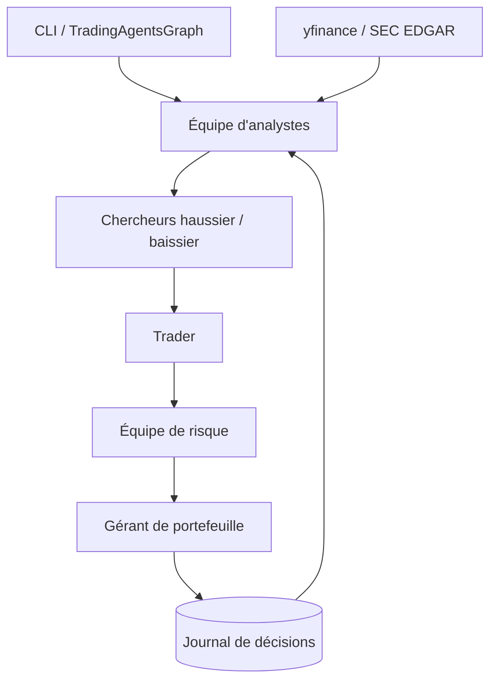

# TauricResearch/TradingAgents

> Multi-agent LLM research framework that simulates a marketplace to generate a decision.

## The problem
Analyzing a position requires considering fundamental factors, market sentiment, news, and technical analysis.
A single, combined approach can combine all these elements, but it also obscures any contradictions between different viewpoints.

## What it actually does
Divides the work into roles: four analysts, two researchers (one bullish and one bearish) who debate,
a trader, a risk management team, and a portfolio manager who approves or rejects the order.
Built on LangGraph; supports around twenty providers, including Ollama and any OpenAI-compatible endpoint.
Logs every decision, calculates the alpha achieved in the next run, and feeds the lesson back into the prompt.
`run_backtest` replays the pipeline on a grid of tickers and dates, and records the decisions made.

## How it is wired


## Trying it
```bash
git clone https://github.com/TauricResearch/TradingAgents.git
cd TradingAgents && pip install .
tradingagents
tradingagents backtest NVDA,AAPL --start 2026-06-01 --end 2026-08-01 --every 7
```

## Cost and gotchas
A single run involves a series of reasoning model calls, and the cost can quickly increase with each round of debate.
SEC EDGAR does not require a key, but it does require a `SEC_EDGAR_USER_AGENT` with a valid contact address.

## What it is not
This is not financial advice or a strategy; the README states that it is a research framework.
It is not reproducible – two identical runs will produce different results, and backtests will not replicate any published figures.
The agents will ignore your positions unless you explicitly pass a `PortfolioContext`.

## Alternatives
- `langchain-ai/langchain`: the underlying orchestration component, without the specific business domain.

## For you
A good subject for studying multi-agent debate and decision-making memory; never use it with real money.
