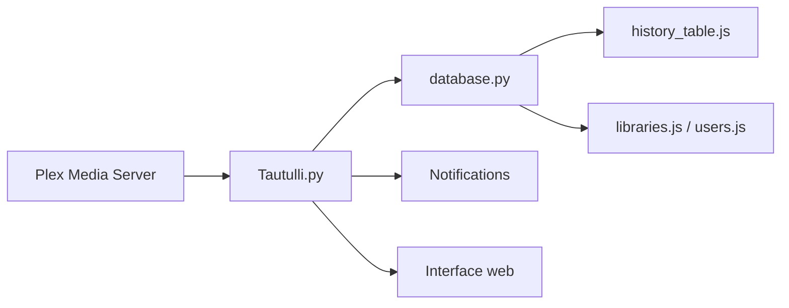

# Tautulli/Tautulli

> Python web application for monitoring, statistics and notifications for Plex servers, for individuals who host their own media.

## The problem
Plex does not provide detailed history of playbacks, users and devices, nor custom alerts.

## What it actually does
Monitors Plex server activity live, keeps viewing history, produces statistics and Highcharts graphs, and sends configurable notifications (streams in progress, media added). Includes user pages, libraries and a sync list. Released as Docker, snap and Windows/macOS installers; Python 3.10 or later.

## How it is wired

## Trying it
No command documented in the provided README: it points to the installation guides in the wiki.

## Cost and gotchas
Free, but useless without a Plex server. Three branches (master, beta, nightly). The README contains a statement about the maintainers' use of AI (August 10, 2026).

## What it is not
Not a data or AI tool: it is personal media library monitoring.

## Alternatives
No alternative cited in the README.

## For you
Ignore for a data/AI/MLOps profile: off-topic professionally, useful only if you host Plex; GPL-3.0.
