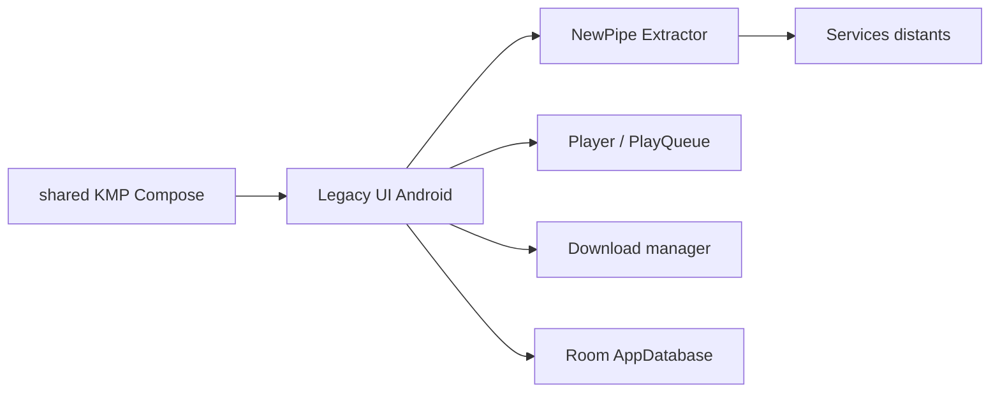

# TeamNewPipe/NewPipe

> Lightweight Android client for YouTube, PeerTube, SoundCloud and others, with no account and no Google services.

## The problem
Watching videos and listening to audio without the official app, without an account and without proprietary libraries.

## What it actually does
The app uses an external library, NewPipe Extractor, which queries the official APIs or parses the sites. Playback up to 4K, background audio, floating mode, local subscriptions without an account, local playlists, downloads, a Room database for history. A Kotlin Multiplatform (Compose) layer is under way alongside the Android app.

## How it is wired

## Trying it
The README gives no install command; it provides the SHA fingerprint of the signing key to verify the APK.

## Cost and gotchas
Free. The README is explicit: the app is in beta, and publishing NewPipe on Google Play violates their terms. The trademark is registered.

## What it is not
Not a Play Store app, nor a finished iOS/PC app: the desktop and iOS hosts are thin shells.

## Alternatives
No alternative named in the README.

## For you
Ignore: personal use on Android, unrelated to data or AI.
