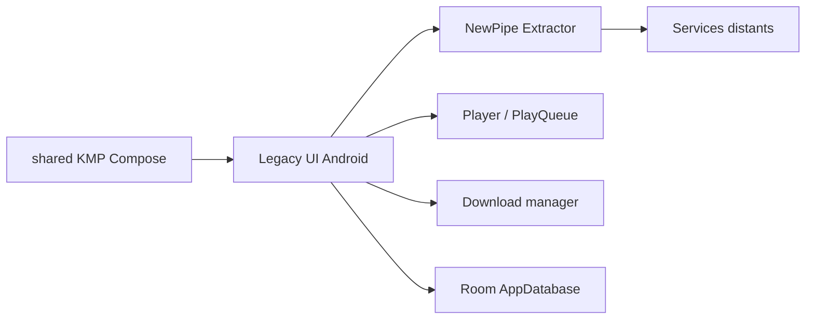

# TeamNewPipe/NewPipe

> Client Android léger pour YouTube, PeerTube, SoundCloud et autres, sans compte ni services Google.

## Le problème
Regarder des vidéos et écouter de l'audio sans appli officielle, sans compte et sans bibliothèques propriétaires.

## Ce que ça fait vraiment
L'application consomme une bibliothèque externe, NewPipe Extractor, qui interroge les API officielles ou analyse les sites. Lecture jusqu'en 4K, audio en arrière-plan, mode flottant, abonnements locaux sans compte, playlists locales, téléchargements, base Room pour l'historique. Une couche Kotlin Multiplatform (Compose) est en cours à côté de l'appli Android.

## Comment c'est branché

## Essayer
Le README ne donne pas de commande d'installation ; il fournit l'empreinte SHA de la clé de signature pour vérifier l'APK.

## Coût et pièges
Gratuit. Le README est explicite : appli en bêta, et publier NewPipe sur Google Play viole leurs conditions. La marque est déposée.

## Ce que ce n'est pas
Pas une appli Play Store ni iOS/PC finalisée : les hôtes bureau et iOS sont des coquilles minces.

## Alternatives
Aucune alternative nommée dans le README.

## Pour toi
Ignorer : usage personnel sur Android, sans rapport avec la data ou l'IA.

