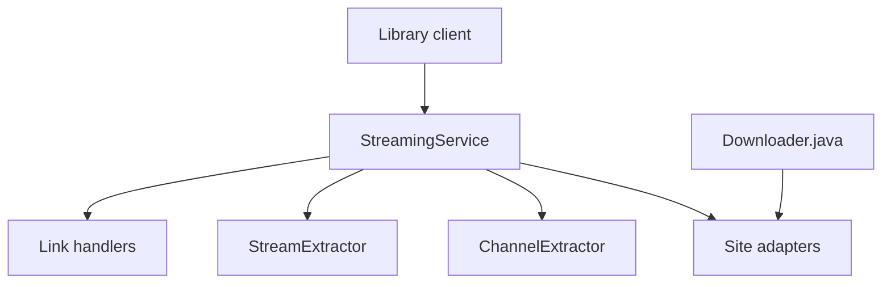

# TeamNewPipe/NewPipeExtractor

> Java library that extracts metadata and streams from streaming sites, the core of the NewPipe application.

## The problem
Reading streaming sites without their official application requires understanding each site and its changes.

## What it actually does
It turns a URL or a search into structured data: videos, channels, playlists, comments, streams. It handles five services: YouTube, SoundCloud, Bandcamp, PeerTube and media.ccc.de.

## How it is wired
Diagram based on the provided diagram.



## Trying it
```bash
./gradlew install
# Gradle : implementation 'com.github.teamnewpipe:NewPipeExtractor:INSERT_VERSION_HERE'
```

## Cost and gotchas
Free via JitPack; you must provide your own implementation of the `Downloader`. GPL-3.0 license: contagious for the code that integrates it.

## What it is not
Not an application, nor a ready-to-use downloader. Depends on the structure of the extracted sites, which changes.

## Alternatives
No alternative named in the README.

## For you
Ignore: useful for an Android streaming application, not for a data or MLOps pipeline.
