# TeamNewPipe/NewPipeExtractor

> Bibliothèque Java qui extrait métadonnées et flux de sites de streaming, cœur de l'application NewPipe.

## Le problème
Lire des sites de streaming sans leur application officielle suppose de comprendre chaque site et ses changements.

## Ce que ça fait vraiment
Elle transforme une URL ou une recherche en données structurées : vidéos, chaînes, playlists, commentaires, flux. Elle gère cinq services : YouTube, SoundCloud, Bandcamp, PeerTube et media.ccc.de.

## Comment c'est branché
Schéma d'après le diagramme fourni.

```mermaid
flowchart TD
    Client["Library client"] --> Service["StreamingService"]
    Service --> Handlers["Link handlers"]
    Service --> Stream["StreamExtractor"]
    Service --> Channel["ChannelExtractor"]
    Service --> Sites["Site adapters"]
    Downloader["Downloader.java"] --> Sites
```



## Essayer
```bash
./gradlew install
# Gradle : implementation 'com.github.teamnewpipe:NewPipeExtractor:INSERT_VERSION_HERE'
```

## Coût et pièges
Gratuit via JitPack ; il faut fournir sa propre implémentation du `Downloader`. Licence GPL-3.0 : contagieuse pour le code qui l'intègre.

## Ce que ce n'est pas
Pas une application, ni un téléchargeur prêt à l'emploi. Dépend de la structure des sites extraits, qui change.

## Alternatives
Aucune alternative nommée dans le README.

## Pour toi
À ignorer : utile pour une application Android de streaming, pas pour un pipeline data ou MLOps.

