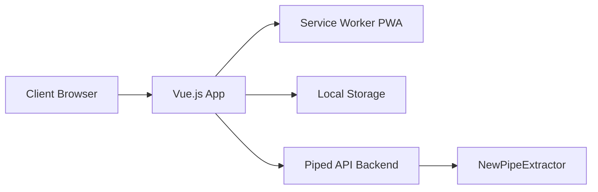

# TeamPiped/Piped

> Alternative YouTube interface, ad-free and tracking-free, self-hostable.

## The problem
YouTube collects a lot of personal data; you want to watch without being tracked.

## What it actually does
Vue.js PWA interface that goes through a separate backend (NewPipeExtractor, no official YouTube API): feeds, playlists, SponsorBlock, LBRY, Return YouTube Dislike, public JSON API, federation via Matrix. No connection to Google's servers, according to the README.

## How it is wired


## Trying it
```bash
pnpm install
pnpm dev
```

## Cost and gotchas
This repository is only the frontend; the full self-hosting setup is described in the external documentation. It depends on a backend and on YouTube's goodwill.

## What it is not
Not a downloader; not a guaranteed service: public instances can disappear. Compliance with YouTube's terms: not documented.

## Alternatives
No named alternative, but derivatives (Piped-Material) are cited.

## For you
Ignore: personal viewing comfort, no value for a data/AI/MLOps profile.
