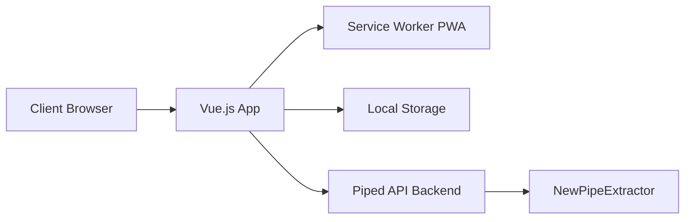

# TeamPiped/Piped

> Interface alternative à YouTube, sans publicité ni suivi, auto-hébergeable.

## Le problème
YouTube collecte beaucoup de données personnelles ; tu veux regarder sans être pisté.

## Ce que ça fait vraiment
Interface Vue.js en PWA qui passe par un backend séparé (NewPipeExtractor, sans API officielle YouTube) : flux, playlists, SponsorBlock, LBRY, Return YouTube Dislike, API JSON publique, fédération via Matrix. Aucune connexion aux serveurs de Google, selon le README.

## Comment c'est branché


## Essayer
```bash
pnpm install
pnpm dev
```

## Coût et pièges
Ce dépôt n'est que le frontal ; l'auto-hébergement complet est décrit dans la documentation externe. Dépend d'un backend et du bon vouloir de YouTube.

## Ce que ce n'est pas
Pas un téléchargeur ; pas un service garanti : les instances publiques peuvent disparaître. Conformité aux conditions de YouTube : non documentée.

## Alternatives
Aucune alternative nommée, mais des dérivés (Piped-Material) sont cités.

## Pour toi
À ignorer : confort de visionnage personnel, sans valeur pour un profil data/IA/MLOps.

