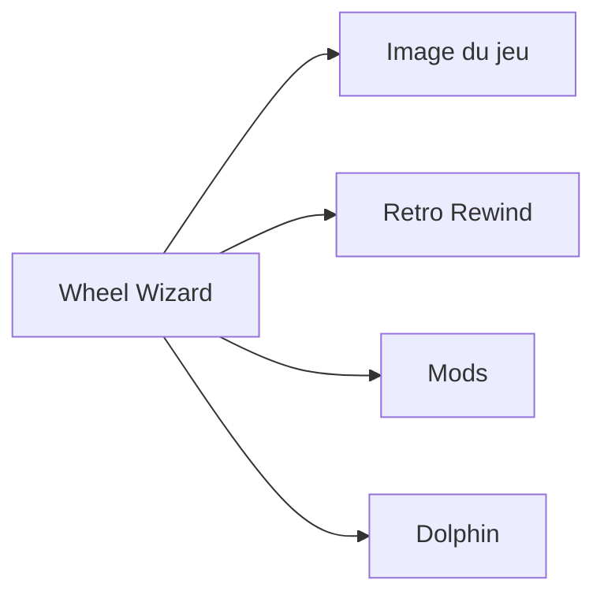

# TeamWheelWizard/WheelWizard

> Mod manager for Mario Kart Wii that installs and updates Retro Rewind in a few clicks.

## The problem
Installing and maintaining Retro Rewind and other Mario Kart Wii mods by hand is tedious.

## What it actually does
Free desktop application that manages mods and updates Retro Rewind, with update notifications. It requires a backup of the game made by you (.iso, .wbfs, .rvz, etc.). Retro Rewind on Dolphin accepts any region; the Wiicompiled version requires a PAL region.

## How it is wired
Simplified diagram based on the sheet, no diagram provided.

## Trying it
No documented command. Download the executable from the GitHub releases; the README mentions a `build.bat` to build it yourself.

## Cost and gotchas
Free. A copy of the game that you extracted yourself is required. Antivirus programs (Windows Defender) report false positives, according to the README, due to the lack of code signing.

## What it is not
Not an emulator nor a generic modding tool: it is centered on Mario Kart Wii. The README says everything can still be done without the application.

## Alternatives
No alternative named in the README.

## For you
Ignore: a gaming tool outside the data / AI / MLOps scope.
