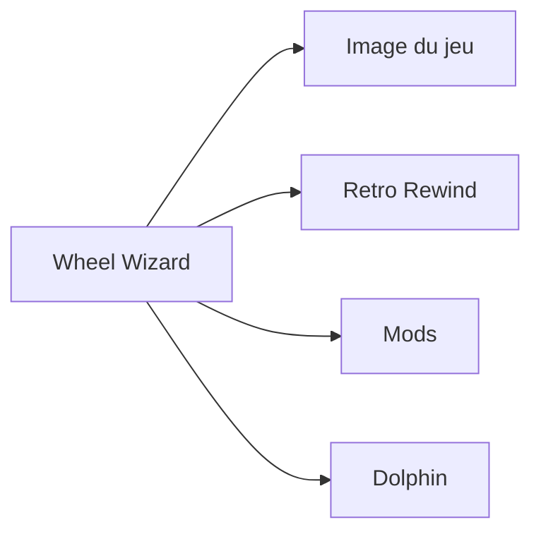

# TeamWheelWizard/WheelWizard

> Gestionnaire de mods pour Mario Kart Wii qui installe et met à jour Retro Rewind en quelques clics.

## Le problème
Installer et maintenir Retro Rewind et d'autres mods de Mario Kart Wii à la main est fastidieux.

## Ce que ça fait vraiment
Application de bureau gratuite qui gère les mods et met à jour Retro Rewind, avec notification des mises à jour. Elle exige une sauvegarde du jeu faite par toi (.iso, .wbfs, .rvz, etc.). Retro Rewind sous Dolphin accepte toute région ; la version Wiicompiled demande une région PAL.

## Comment c'est branché
Schéma simplifié d'après la fiche, sans diagramme fourni.

## Essayer
Aucune commande documentée. Télécharger l'exécutable dans les releases GitHub ; le README mentionne un `build.bat` pour compiler soi-même.

## Coût et pièges
Gratuit. Une copie du jeu que tu as extraite toi-même est nécessaire. Des antivirus (Windows Defender) signalent des faux positifs, d'après le README, faute de signature de code.

## Ce que ce n'est pas
Pas un émulateur ni un outil de modding générique : il est centré sur Mario Kart Wii. Le README dit que tout reste faisable sans l'application.

## Alternatives
Aucune alternative nommée dans le README.

## Pour toi
À ignorer : outil de jeu hors du périmètre data / IA / MLOps.

