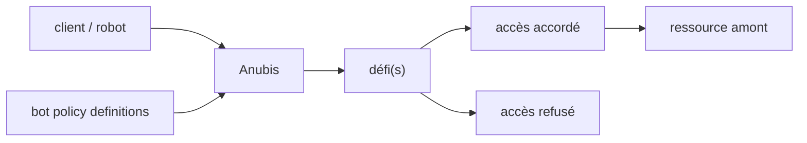

# TecharoHQ/anubis

> Application firewall that imposes challenges on clients to keep scraping bots out.

## The problem
AI companies' bots overload small sites: bandwidth and CPU go to automated requests that the origin server pays for.

## What it actually does
Anubis sits in front of a resource and "weighs the soul" of the connection by means of one or more challenges before letting it through. The README describes it as as lightweight as possible, to stay affordable. Bot policy definitions let you explicitly allowlist the bots you want to keep; a set of known "good bots" is being built. No detail on the nature of the challenges, installation or configuration is given in this README.

## How it is wired

## Trying it
No command is documented in this README; it points to the site `anubis.techaro.lol`.

## Cost and gotchas
The README itself warns: it is a nuclear response. The site will be blocked for small scrapers and may hinder "good bots" such as Internet Archive. Neither license, prerequisites, nor deployment are stated here.

## What it is not
Not a common need: the README says that in most cases you don't need it and that Cloudflare is enough — Anubis targets situations where you cannot or do not want to use it. Not a ready-made selective filter: the allowlist is yours to write.

## Alternatives
- Cloudflare: named by the README as the solution to prefer by default.

## For you
Not relevant to your data work; worth knowing about if you host a public site in your name.
