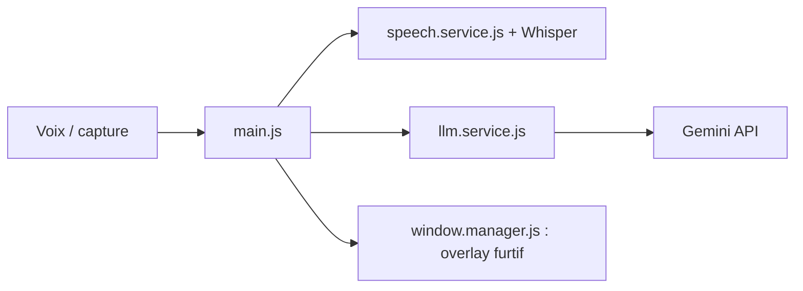

# TechyCSR/OpenCluely

> Technical interview copilot whose overlay is invisible to screen-sharing tools.

## The problem
The README aims at getting real-time AI help during technical interviews without the interviewer seeing it.

## What it actually does
Electron app: screenshots sent directly to Gemini, voice transcribed by local Whisper or Azure Speech, streamed answers in an overlay and a chat, session memory. The windows hide from Zoom, Meet, Teams, Discord and OBS captures and conceal themselves when a share starts. Windows and Linux installers; macOS from source.

## How it is wired


## Trying it
```bash
git clone https://github.com/TechyCSR/OpenCluely.git
cd OpenCluely
./setup.sh
```
Then paste the `GEMINI_API_KEY` key in the Settings.

## Cost and gotchas
Gemini key (free via Google AI Studio according to the README); local Whisper weighs on disk and CPU/GPU. The README says "responsible for the interview rules".

## What it is not
Not an honest preparation tool: the flagship feature is hiding the help, which can break the rules of a recruitment process.

## Alternatives
The README cites Vysper as an interface inspiration.

## For you
Ignore: its value rests on concealment in interviews, with ethical and professional risks, and it brings nothing to data work.
