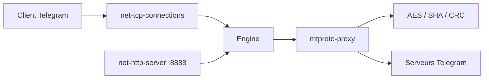

# TelegramMessenger/MTProxy

> Simple MTProto proxy for relaying Telegram traffic, aimed at server administrators.

## The problem
Reaching Telegram when the network blocks or filters it.

## What it actually does
C daemon: accepts TCP connections from Telegram clients, decrypts/encrypts (AES, SHA, CRC) and relays to Telegram servers; master + workers (`-M`), stats page on localhost:8888. Optional "random padding" (the `dd` prefix of the secret) against packet-size detection. The official Docker image is flagged as obsolete.

## How it is wired


## Trying it
```bash
apt install git curl build-essential libssl-dev zlib1g-dev
git clone https://github.com/TelegramMessenger/MTProxy
cd MTProxy
make && cd objs/bin
curl -s https://core.telegram.org/getProxySecret -o proxy-secret
curl -s https://core.telegram.org/getProxyConfig -o proxy-multi.conf
head -c 16 /dev/urandom | xxd -ps
./mtproto-proxy -u nobody -p 8888 -H 443 -S <secret> --aes-pwd proxy-secret proxy-multi.conf -M 1
```

## Cost and gotchas
A public server with port 443. The Telegram configuration must be refreshed every day. No license declared in the catalog; last push 2026-08-04.

## What it is not
Not a general-purpose proxy nor an anonymity tool. The code diagram is written in Vietnamese.

## Alternatives
No alternative named in the README.

## For you
Ignore: a Telegram network utility unrelated to data/AI/MLOps, and with no explicit license.
