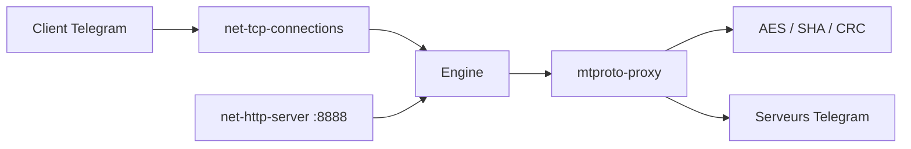

# TelegramMessenger/MTProxy

> Proxy MTProto simple pour relayer le trafic Telegram, destiné aux administrateurs de serveurs.

## Le problème
Accéder à Telegram quand le réseau le bloque ou le filtre.

## Ce que ça fait vraiment
Démon C : accepte les connexions TCP des clients Telegram, déchiffre/chiffre (AES, SHA, CRC) et relaie vers les serveurs Telegram ; maître + workers (`-M`), page de stats sur localhost:8888. Option de « random padding » (préfixe `dd` du secret) contre la détection par taille de paquets. L'image Docker officielle est signalée comme obsolète.

## Comment c'est branché


## Essayer
```bash
apt install git curl build-essential libssl-dev zlib1g-dev
git clone https://github.com/TelegramMessenger/MTProxy
cd MTProxy
make && cd objs/bin
curl -s https://core.telegram.org/getProxySecret -o proxy-secret
curl -s https://core.telegram.org/getProxyConfig -o proxy-multi.conf
head -c 16 /dev/urandom | xxd -ps
./mtproto-proxy -u nobody -p 8888 -H 443 -S <secret> --aes-pwd proxy-secret proxy-multi.conf -M 1
```

## Coût et pièges
Un serveur public avec port 443. La configuration Telegram doit être rafraîchie chaque jour. Aucune licence déclarée au catalogue ; dernier push 2026-08-04.

## Ce que ce n'est pas
Pas un proxy généraliste ni un outil d'anonymat. Le diagramme du code est rédigé en vietnamien.

## Alternatives
Aucune alternative nommée dans le README.

## Pour toi
À ignorer : utilitaire réseau Telegram sans lien avec data/IA/MLOps, et sans licence explicite.

