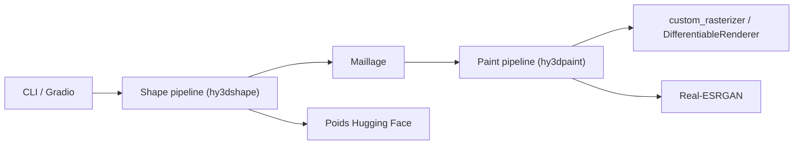

# Tencent-Hunyuan/Hunyuan3D-2.1

> Open system that generates a PBR-textured 3D mesh from an image, for research and 3D work.

## The problem
Creating a textured 3D asset from an image requires manual modeling and texturing.

## What it actually does
Two stages: Hunyuan3D-Shape (3.3B, flow matching) produces the mesh, then Hunyuan3D-Paint (2B) applies PBR textures via differentiable rendering and inpainting. Weights and training code are released. Diffusers-style API and Gradio app; CUDA rasterizer compiled locally.

## How it is wired


## Trying it
```bash
pip install torch==2.5.1 torchvision==0.20.1 torchaudio==2.5.1 --index-url https://download.pytorch.org/whl/cu124
pip install -r requirements.txt
python3 gradio_app.py \
  --model_path tencent/Hunyuan3D-2.1 \
  --subfolder hunyuan3d-dit-v2-1 \
  --texgen_model_path tencent/Hunyuan3D-2.1 \
  --low_vram_mode
```

## Cost and gotchas
Stated VRAM: 10 GB (shape), 21 GB (texture), 29 GB (both). C++/CUDA extensions must be compiled; PyTorch 2.5.1 cu124 tested.

## What it is not
The license is not identified by GitHub: check its terms before commercial use. Benchmark comparisons are supplied by the authors themselves.

## Alternatives
- Trellis, TripoSG, Step1X-3D: compared in the README's results table.

## For you
Worth watching: interesting if you have a 24 GB+ GPU and a 3D need, but read the license before any use.
