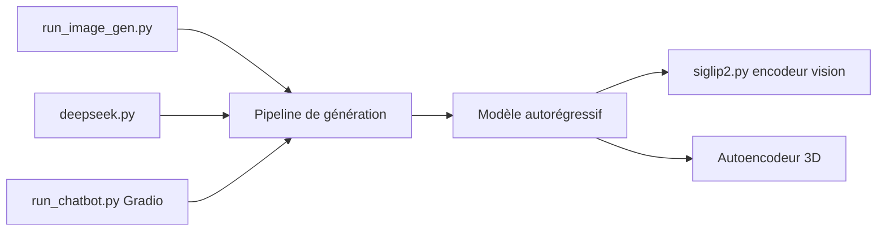

# Tencent-Hunyuan/HunyuanImage-3.0

> Autoregressive multimodal model for image generation and editing, for teams with several 80 GB GPUs.

## The problem
Open image models mostly rely on diffusion architectures; here Tencent offers a unified text-image model that understands and generates.

## What it actually does
MoE model with 80 billion parameters (13 billion active per token, 64 experts). Three checkpoints: base (text to image), Instruct (editing, fusion of up to 3 images, rewriting and "think" reasoning) and Instruct-Distil (8 steps). Interfaces: `run_image_gen.py` CLI, Gradio demo, vLLM integration. A prompt rewriter goes through Tencent Cloud (DeepSeek/LKEAP keys).

## How it is wired


## Trying it
```bash
pip install torch==2.8.0 torchvision==0.23.0 torchaudio==2.8.0 --index-url https://download.pytorch.org/whl/cu128
pip install -r requirements.txt
hf download tencent/HunyuanImage-3.0-Instruct --local-dir ./HunyuanImage-3-Instruct
export MODEL_PATH="./HunyuanImage-3-Instruct"
bash run_demo_instruct.sh
```

## Cost and gotchas
Recommended VRAM: at least 3 × 80 GB (base) and 8 × 80 GB (Instruct). CUDA 12.8, Python 3.12+. First inference with FlashInfer: about 10 minutes of compilation. The model folder name must not contain a dot.

## What it is not
Not runnable on a consumer GPU. "Multi-turn" is still to be done. The announced comparisons against closed models are the authors' own. License present but not recognized by GitHub: read it before any commercial use.

## Alternatives
No alternative named in the README.

## For you
Worth watching: the model is technically interesting, but the required hardware and the unidentified license prevent direct team use.
