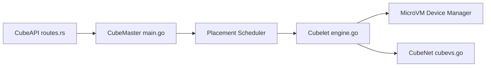

# TencentCloud/CubeSandbox

> Service of isolated, E2B-compatible microVM sandboxes for running AI agent code.

## The problem
Running agent-generated code requires strong isolation and fast startup.

## What it actually does
Each sandbox is a KVM microVM (RustVMM) with its own kernel. Claims: startup under 60 ms, less than 5 MB overhead, snapshots and rollback, volumes, eBPF network isolation, an L7 credential-injection proxy. Compatible with the E2B SDK by changing one environment variable. Web console on port 12088.

## How it is wired


## Trying it
```bash
# Aucune commande shell dans ce README ; ouvrir la console après déploiement :
# http://<control-node IP>:12088
```
(No shell command in this README; open the console after deployment.)

## Cost and gotchas
Linux x86_64 with KVM required (the dev environment is "not recommended, poor performance"). Kubernetes deployment in preview. Performance figures are supplied by the project. License not identified.

## What it is not
It is not a simple Docker container: it is infrastructure to deploy. Recent repository (April 2026).

## Alternatives
- E2B: the README cites it as the compatible interface and the reference cloud.

## For you
Worth watching: relevant for running agents safely on your own infrastructure, but young, with a license to verify, and requiring KVM.
