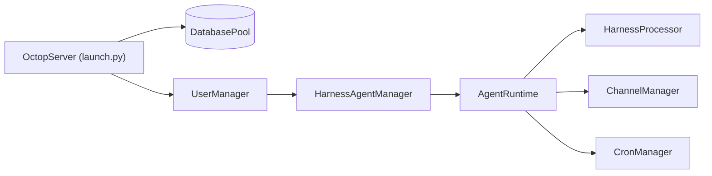

# TencentCloud/Octop

> Self-hosted, multi-user, multi-agent AI assistant for households and small teams.

## The problem
Hosted AI assistants keep conversations, files and credentials with the provider, and are hard to share among several people with different needs.

## What it actually does
A single Python process (FastAPI) serves a web dashboard, CLI, messaging apps (Feishu, DingTalk, QQ, Discord, WeCom) and cron; all state lives in `~/.octop/` (SQLite by default, PostgreSQL optional).
Each user has several agents with their own workspace, providers, channels and cron; library of experts, 16 MBTI personas.
RAG over your documents, OAuth and MCP connectors, plugins, headless Chromium, remote terminal and desktop.
ACP in both directions: `octop acp` for an IDE, or delegation to OpenCode, Claude Code, Codex. JWT, tool approval, shell rules, PII masking.

## How it is wired


## Trying it
```bash
curl -fsSL https://finnie-1258344699.cos.ap-guangzhou.myqcloud.com/octop/install.sh | bash
octop init
octop run
docker compose -f docker/docker-compose.yml up -d
```

## Cost and gotchas
Free in itself; models at your expense (or local). Recommended installation is `curl | bash` from a COS bucket. A few GB of RAM, plus model and embedding caches.

## What it is not
Not fully open today: harness-agent, harness-gateway, harness-memory and harness-browser are "in preparation" for open source, with no published link.
Not distributed: a single process, no message queue.
Support is mostly in Chinese (WeCom group).

## Alternatives
No alternative named in the README.

## For you
Worth watching until the harness-* components are published; until then, the core remains unreadable.
