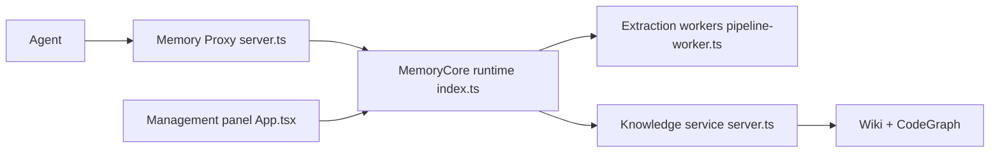

# TencentCloud/TencentDB-Agent-Memory

> Shared memory hub for agent teams: conversations, skills, wiki and code graph.

## The problem
Each new agent or session relearns the project from scratch, and experience does not circulate within the team.

## What it actually does
Three services (`memory-core`, `memory-hub`, proxy). Conversations are distilled into layers L0 to L3, with BM25 + vector search. Skills are extracted, versioned and shareable. Wiki and CodeGraph are built from imported docs and repositories. The proxy enables no-code integration: you change the agent's base URL. Visibility `private`, `team`, `restricted`. PersonaMem benchmark: 48% → 76%.

## How it is wired


## Trying it
```bash
git clone https://github.com/TencentCloud/TencentDB-Agent-Memory.git
cd TencentDB-Agent-Memory/deploy/global-images
cp .env.example .env
./start-all.sh
```

## Cost and gotchas
Two sets of LLM parameters to fill in (memory and proxy), so calls are at your expense. CodeGraph favors public HTTPS repositories. Wiki and CodeGraph build asynchronously. MongoDB storage is experimental.

## What it is not
Not a simple chat history. Automatic memory routing is not finished: the Hub uses a manual link. The license is not identified by GitHub.

## Alternatives
No alternative named in the README (it compares with "Standard RAG" and chat history, both generic).

## For you
Worth watching: relevant for an MLOps team that wants to pool agent memory; license to clarify and only one published benchmark.
