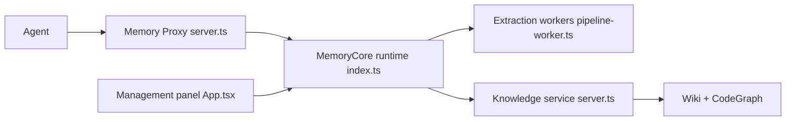

# TencentCloud/TencentDB-Agent-Memory

> Hub de mémoire partagée pour équipes d'agents : conversations, compétences, wiki et graphe de code.

## Le problème
Chaque nouvel agent ou nouvelle session réapprend le projet depuis zéro, et l'expérience ne circule pas dans l'équipe.

## Ce que ça fait vraiment
Trois services (`memory-core`, `memory-hub`, proxy). Les conversations sont distillées en couches L0 à L3, avec recherche BM25 + vecteurs. Les compétences sont extraites, versionnées et partageables. Wiki et CodeGraph sont construits à partir de docs et de dépôts importés. Le proxy permet l'intégration sans code : on change l'URL de base de l'agent. Visibilité `private`, `team`, `restricted`. Benchmark PersonaMem : 48 % → 76 %.

## Comment c'est branché


## Essayer
```bash
git clone https://github.com/TencentCloud/TencentDB-Agent-Memory.git
cd TencentDB-Agent-Memory/deploy/global-images
cp .env.example .env
./start-all.sh
```

## Coût et pièges
Deux groupes de paramètres LLM à renseigner (mémoire et proxy), donc appels à ta charge. CodeGraph privilégie les dépôts HTTPS publics. Wiki et CodeGraph se construisent en asynchrone. Stockage MongoDB expérimental.

## Ce que ce n'est pas
Pas un simple historique de chat. Le routage automatique de mémoire n'est pas terminé : le Hub utilise un lien manuel. La licence n'est pas identifiée par GitHub.

## Alternatives
Aucune alternative nommée dans le README (il compare avec « Standard RAG » et l'historique de chat, génériques).

## Pour toi
À surveiller : pertinent pour une équipe MLOps qui veut mutualiser la mémoire d'agents ; licence à clarifier et un seul benchmark publié.

