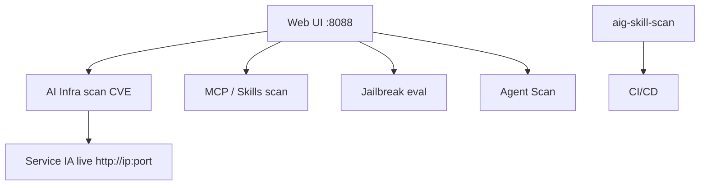

# Tencent/AI-Infra-Guard

> AI red teaming platform (Tencent Zhuque Lab): AI infrastructure vulnerability scanning, MCP, skills, jailbreak.

## The problem
Self-assessing the security of an AI infrastructure (model servers, MCP, agent skills, jailbreak) requires many scattered tools and an up-to-date CVE database.

## What it actually does
Integrates ClawScan (OpenClaw security scan), Agent Scan (multi-agent framework for Dify/Coze workflows), MCP Server & Agent Skills scan (14 risk categories, source or URL), AI infrastructure vulnerability scan (100+ components — Ollama, ComfyUI, vLLM, n8n, Triton — 2000+ CVEs), and jailbreak evaluation. `aig-skill-scan` as a CLI for CI/CD (SkillTrustBench taxonomy T01-T09). API Relay Checker (model fingerprinting).

## How it is wired


## Trying it
```bash
git clone https://github.com/Tencent/AI-Infra-Guard.git
cd AI-Infra-Guard
docker-compose -f docker-compose.images.yml up -d
```
```bash
pip install aig-skill-scan
export LLM_API_KEY="your-api-key"
aig-skill-scan --repo /path/to/your/skill -m deepseek-v4-flash --language en -o result.json
```

## Cost and gotchas
Free (Apache 2.0), 4 GB+ RAM, Docker 20.10+. An LLM key is required for skill-scan. **No authentication**: do not deploy on a public network. Online Pro version by invitation.

## What it is not
Not a firewall nor runtime protection: an offensive audit scanner. Positioned for internal company/individual use.

## Alternatives
- A.S.E (AICGSecEval): security evaluation of AI-generated code (same publisher), cited as complementary.

## For you
Directly relevant for auditing an AI infrastructure (vLLM, Ollama, MCP, skills) before going to production; worth knowing.
