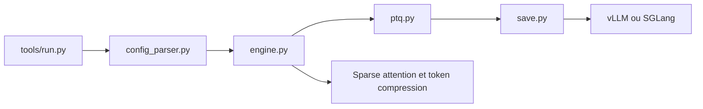

# Tencent/AngelSlim

> Large-model compression toolkit: quantization, speculative decoding, sparse attention, token pruning.

## The problem
Deploying large models is expensive in memory and latency; each compression method has its own tooling.

## What it actually does
A compression engine driven by YAML configuration files: post-training quantization (static and dynamic FP8, INT8, INT4 GPTQ/AWQ, NVFP4), quantization-aware training and distillation, sparse attention, visual token pruning, diffusion caching, and speculative decoding via the AngelSpec submodule (DFly, MTP). Covers LLMs, vision-language models, diffusion and audio. Output deployable with vLLM or SGLang.

## How it is wired


## Trying it
```bash
pip install angelslim
python3 tools/run.py -c configs/qwen3/fp8_static/qwen3-1_7b_fp8_static.yaml
bash scripts/deploy/run_vllm.sh --model-path $MODEL_PATH --port 8080 -d 0,1,2,3 -t 4 -p 1 -g 0.8 --max-model-len 4096
```

## Cost and gotchas
A GPU is required; quantizing very large models is announced on a single card. Speculative training needs several GPUs, Mooncake and the submodule cloned with `--recursive`. A license is present but not recognized by GitHub.

## What it is not
Not an inference server: it produces compressed models to be served elsewhere. The speed gains of speculative decoding (up to 2.86 times) are the team's own measurements on its own models.

## Alternatives
No alternative named in the README.

## For you
Adopt on a trial basis: quantizing a model through a configuration file is straightforward and useful in MLOps, provided you check the license before any commercial use.
