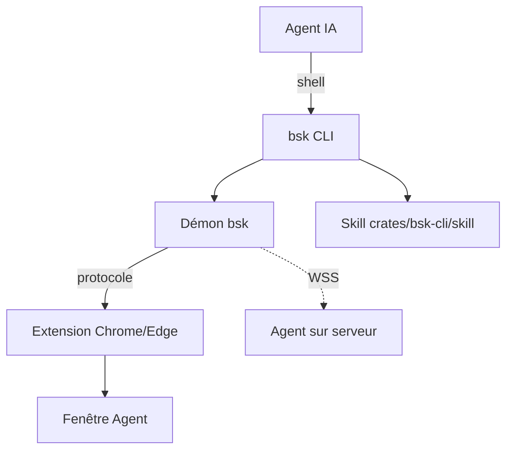

# Tencent/BrowserSkill

> CLI and extension that let an AI agent drive your Chrome or Edge with your open sessions.

## The problem
Agents can't access sites where you're already logged in, nor the real state of the browser.

## What it actually does
The `bsk` CLI and its daemon connect an agent to the browser extension. The agent reads, clicks, fills in forms, takes captures, exports tables as JSON/CSV, records videos and collects debugging evidence (requests, console). Work happens in a separate Agent window, with shared control.

## How it is wired


## Trying it
```bash
curl -fsSL https://raw.githubusercontent.com/Tencent/BrowserSkill/main/install.sh | sh
bsk install-skill
bsk doctor
bsk session start --json
```

## Cost and gotchas
Free; you need to install the extension and an agent. The window shares your logins: it is not a sandbox, the agent acts with your rights.

## What it is not
Not an isolated browser nor a cloud service. Debugging evidence may contain sensitive data despite redaction. The CLI, daemon and extension versions must stay aligned.

## Alternatives
No alternative named in the README.

## For you
Worth watching: useful for automating authenticated sites, but giving an agent your real sessions requires real security discipline.
