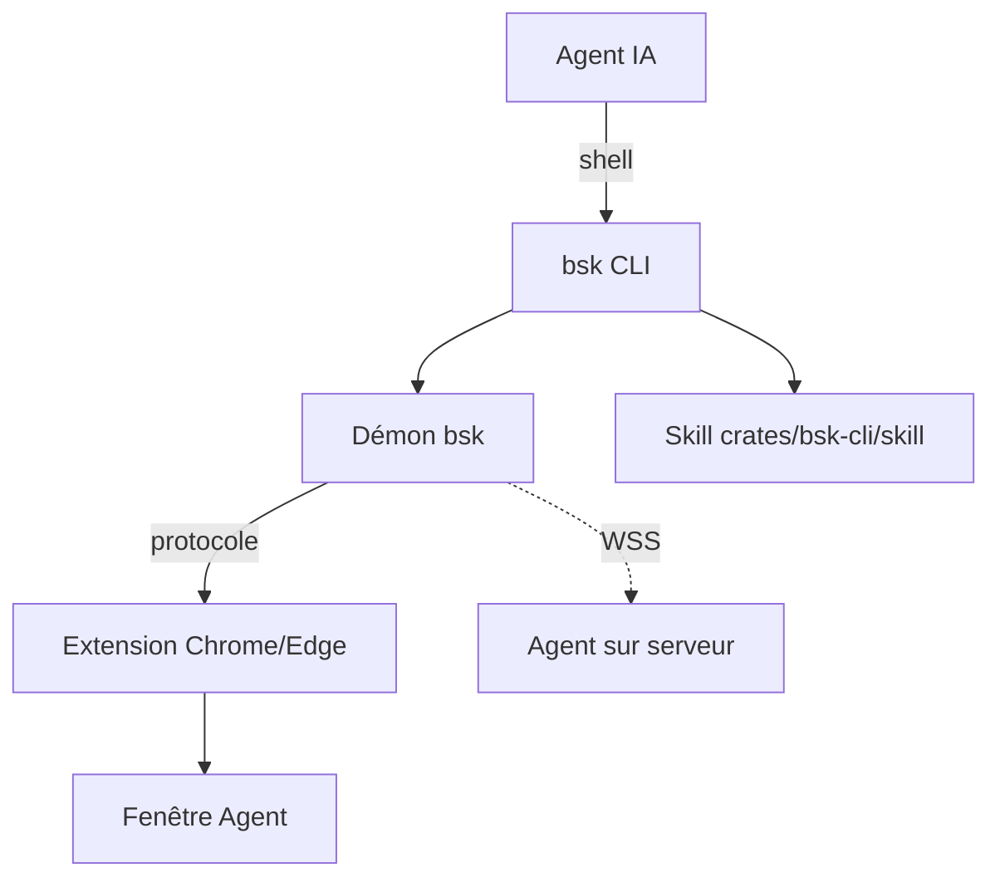

# Tencent/BrowserSkill

> CLI et extension qui laissent un agent IA piloter ton Chrome ou Edge avec tes sessions ouvertes.

## Le problème
Les agents n'accèdent pas aux sites où tu es déjà connecté, ni à l'état réel du navigateur.

## Ce que ça fait vraiment
La CLI `bsk` et son démon relient un agent à l'extension du navigateur. L'agent lit, clique, remplit, capture, exporte des tableaux en JSON/CSV, enregistre des vidéos et collecte des preuves de débogage (requêtes, console). Le travail se fait dans une fenêtre Agent séparée, avec contrôle partagé.

## Comment c'est branché


## Essayer
```bash
curl -fsSL https://raw.githubusercontent.com/Tencent/BrowserSkill/main/install.sh | sh
bsk install-skill
bsk doctor
bsk session start --json
```

## Coût et pièges
Gratuit ; il faut installer l'extension et un agent. La fenêtre partage tes connexions : ce n'est pas un bac à sable, l'agent agit avec tes droits.

## Ce que ce n'est pas
Pas un navigateur isolé ni un service cloud. Les preuves de débogage peuvent contenir des données sensibles malgré la rédaction. Les versions CLI, démon et extension doivent rester alignées.

## Alternatives
Aucune alternative nommée dans le README.

## Pour toi
À surveiller : utile pour automatiser des sites authentifiés, mais donner à un agent tes sessions réelles demande une vraie discipline de sécurité.

