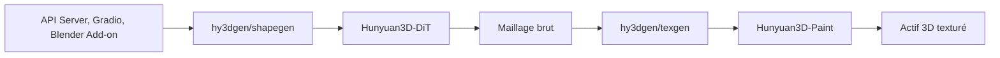

# Tencent/Hunyuan3D-2

> Generates textured 3D objects from an image, for artists and computer vision researchers.

## The problem
Producing a 3D mesh with high-resolution textures takes hours of manual modeling.

## What it actually does
Two-stage pipeline: Hunyuan3D-DiT creates the mesh from an image, Hunyuan3D-Paint synthesizes the texture (also for an existing mesh). Several variants (mini, multiview, Turbo, Fast). Usable in code (diffusers-style API), Gradio app, API server or Blender add-on. The open-source roadmap lists a TensorRT version as not done.

## How it is wired


## Trying it
```bash
pip install -r requirements.txt
pip install -e .
python3 gradio_app.py --model_path tencent/Hunyuan3D-2mini --subfolder hunyuan3d-dit-v2-mini --texgen_model_path tencent/Hunyuan3D-2 --low_vram_mode
python api_server.py --host 0.0.0.0 --port 8080
```

## Cost and gotchas
6 GB of VRAM for shape, 16 GB for shape and texture. Texture requires compiling `custom_rasterizer` and `differentiable_renderer` (CUDA).

## What it is not
Not a ready-to-use service: an official website exists for those who do not want to host anything. The README's comparisons cite anonymous models. License not declared in the catalog.

## Alternatives
No alternative named in the README.

## For you
Worth watching: interesting if you work on generative 3D, but the GPU and CUDA compilation make it a project, and the license is not declared.
