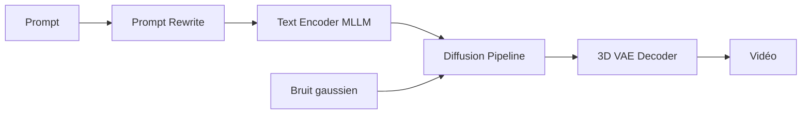

# Tencent/HunyuanVideo

> Open text-to-video generation model (13 billion parameters) with inference code.

## The problem
Generating quality video with a model for which you have the weights and the code.

## What it actually does
The repository contains the PyTorch definitions, the weights and the inference: MLLM text encoder, causal 3D VAE, "dual-stream to single-stream" diffusion transformer, prompt rewriting (Normal and Master modes). Single-GPU inference, multi-GPU via xDiT, FP8 weights, Gradio demo. The README claims better results than closed models, according to an internal human evaluation.

## How it is wired


## Trying it
```bash
python3 sample_video.py \
    --video-size 720 1280 \
    --video-length 129 \
    --infer-steps 50 \
    --prompt "A cat walks on the grass, realistic style." \
    --flow-reverse \
    --use-cpu-offload \
    --save-path ./results
```

## Cost and gotchas
Top-end GPU memory: 60 GB for 720×1280×129 frames, 45 GB for 544×960; 80 GB recommended. Linux tested. Times of 1904 s on one GPU for 720p, 337 s on 8 GPUs. Last push on 2026-06-29.

## What it is not
Not runnable on a consumer GPU without compromises. The license is "present but not identified": read the file before any commercial use.

## Alternatives
The README cites mochi-1, CogVideoX, Flux.1 and SD3 as models served by xDiT.

## For you
Worth watching: a useful reference for open video generation, but the hardware cost and the uncertain license limit adoption.
