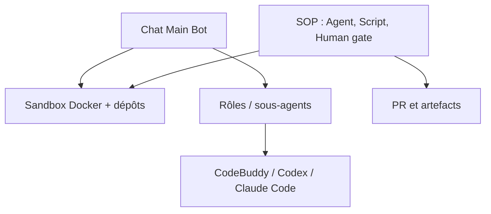

# Tencent/LoopForge

> Self-hosted workspace where coding agents deliver software through repeatable workflows with human validation.

## The problem
Handing a bug to a coding agent gives a variable result: skipped plan, forgotten tests, review by the agent itself, stopping halfway without anyone noticing.

## What it actually does
A chat "Main Bot" opens a Docker sandbox, fetches your repositories, delegates to roles (planning, implementation, review, testing) and opens the PR. An SOP chains Agent, Script, Human gate and sub-SOP nodes, with artifacts, logs and resumption from any node. The executors are CodeBuddy, Codex or Claude Code. A local variant, LoopForge Local, installs through npm.

## How it is wired
Simplified diagram based on the note, no diagram provided.



## Trying it
```bash
git clone https://github.com/Tencent/LoopForge.git
cd LoopForge
./start.sh
npx -y loopforge-cli@latest install claude
```

## Cost and gotchas
Model calls are at your expense (the executors' keys). The service listens on `0.0.0.0:8090` and mounts the host's Docker socket: reserved for a trusted team, not multi-tenant. The license is judged unidentified by GitHub although the README mentions MIT.

## What it is not
Not a general-purpose workflow builder like Dify, n8n or Flowise, nor a replacement for Claude Code: it orchestrates them. The chat interface is in Chinese for now.

## Alternatives
Dify, n8n, Flowise: general-purpose AI workflows, better suited if you do not need code delivery.

## For you
Worth watching: the idea of SOPs with human validation gates is useful, but the repository is young, the license needs confirming and the isolation is weak.
