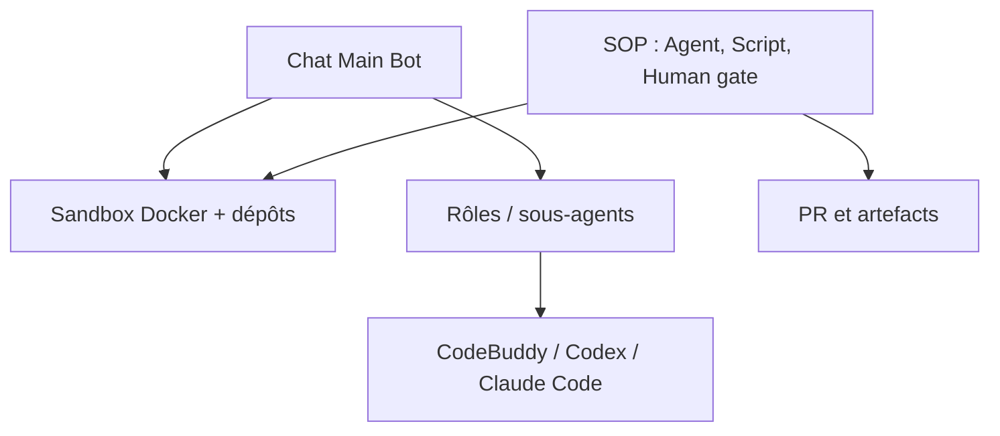

# Tencent/LoopForge

> Espace de travail auto-hébergé où des agents de code livrent du logiciel via des workflows répétables avec validation humaine.

## Le problème
Confier un bug à un agent de code donne un résultat variable : plan sauté, tests oubliés, relecture par l'agent lui-même, arrêt à mi-chemin sans que personne le voie.

## Ce que ça fait vraiment
Un « Main Bot » en chat ouvre un bac à sable Docker, récupère vos dépôts, délègue à des rôles (planification, implémentation, revue, test) et ouvre la PR. Un SOP enchaîne des nœuds Agent, Script, Human gate et sous-SOP, avec artefacts, journaux et reprise depuis n'importe quel nœud. Les exécuteurs sont CodeBuddy, Codex ou Claude Code. Une variante locale, LoopForge Local, s'installe via npm.

## Comment c'est branché
Schéma simplifié d'après la fiche, sans diagramme fourni.



## Essayer
```bash
git clone https://github.com/Tencent/LoopForge.git
cd LoopForge
./start.sh
npx -y loopforge-cli@latest install claude
```

## Coût et pièges
Les appels aux modèles sont à ta charge (clés des exécuteurs). Le service écoute sur `0.0.0.0:8090` et monte le socket Docker de l'hôte : réservé à une équipe de confiance, pas du multi-tenant. La licence est jugée non identifiée par GitHub bien que le README parle de MIT.

## Ce que ce n'est pas
Pas un constructeur de workflows généraliste façon Dify, n8n ou Flowise, ni un remplaçant de Claude Code : il les orchestre. L'interface du chat est en chinois pour l'instant.

## Alternatives
Dify, n8n, Flowise : workflows IA généralistes, plus adaptés si tu n'as pas besoin de livraison de code.

## Pour toi
À surveiller : l'idée de SOP avec portes de validation humaine est utile, mais le dépôt est jeune, la licence à confirmer et l'isolation faible.

