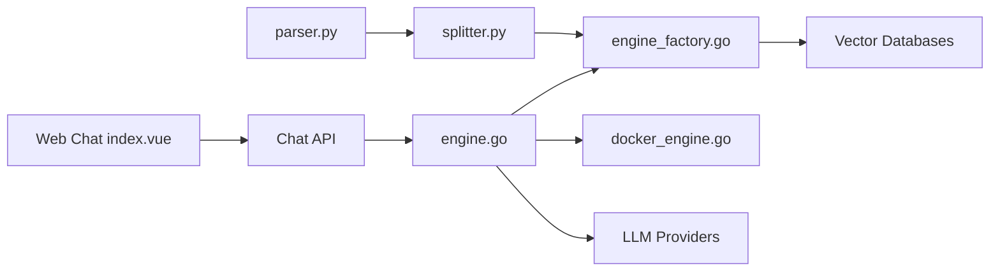

# Tencent/WeKnora

> Self-hosted platform for RAG, ReAct agents and an automatic wiki over company documents.

## The problem
Turning scattered documents (PDF, Office, wikis) into a queryable base with citations, permissions and traceability requires assembling many building blocks.

## What it actually does
Multi-format, multi-source ingestion (Feishu, GitLab, Notion, RSS...), chunking, BM25/dense/GraphRAG indexing.
Fast RAG Q&A, ReAct agent with MCP, Docker/E2B sandboxes and web search; Wiki mode generated by agents with history.
Multi-workspace RBAC, scoped API keys, Langfuse tracing, IM channels (Slack, Telegram...).
Interchangeable vector DBs: pgvector, Elasticsearch, Milvus, Qdrant...

## How it is wired


## Trying it
```bash
git clone https://github.com/Tencent/WeKnora.git
cd WeKnora
cp .env.example .env
docker compose pull
docker compose up -d
```

## Cost and gotchas
Free, LLM API key at your expense (or Ollama). Additional Docker profiles (Neo4j, MinIO, Langfuse). Not to be exposed on the Internet according to the README.

## What it is not
Not a lightweight RAG library: it is a complete platform to operate. Ecosystem strongly oriented toward Chinese tools (WeChat, Feishu).

## Alternatives
No alternative named in the README.

## For you
Watch: a useful reference for an internal knowledge base with RBAC, but heavy to run; check the license before any pilot.
