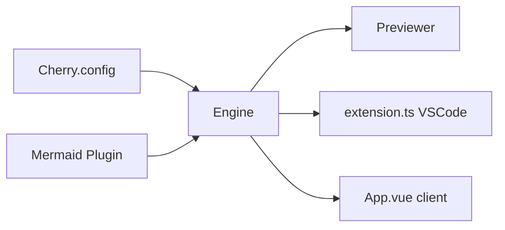

# Tencent/cherry-markdown

> Pure JavaScript Markdown editor, for browser or Node, with streaming rendering for AI chats.

## The problem
Embedding a rich Markdown editor (diagrams, formulas, tables) without depending on a front-end framework.

## What it actually does
An engine (`Engine`, `Previewer`, `Cherry.config`) turns Markdown into HTML, with XSS filtering (DomPurify). Plugins add Mermaid and PlantUML. Stream mode completes unfinished fragments while tokens arrive. A Tauri client and a VSCode extension exist.

## How it is wired


## Trying it
```bash
npm install cherry-markdown --save
```

## Cost and gotchas
Free. The license is present but not recognized by GitHub: read it before commercial use.

## What it is not
It is not a turnkey chat renderer: Stream mode is one of the builds (Full, Core, Stream, Engine) that you have to choose.

## Alternatives
No alternative named in the README.

## For you
Worth watching: useful for cleanly displaying an LLM's streamed output in a web interface, if the license suits you.
