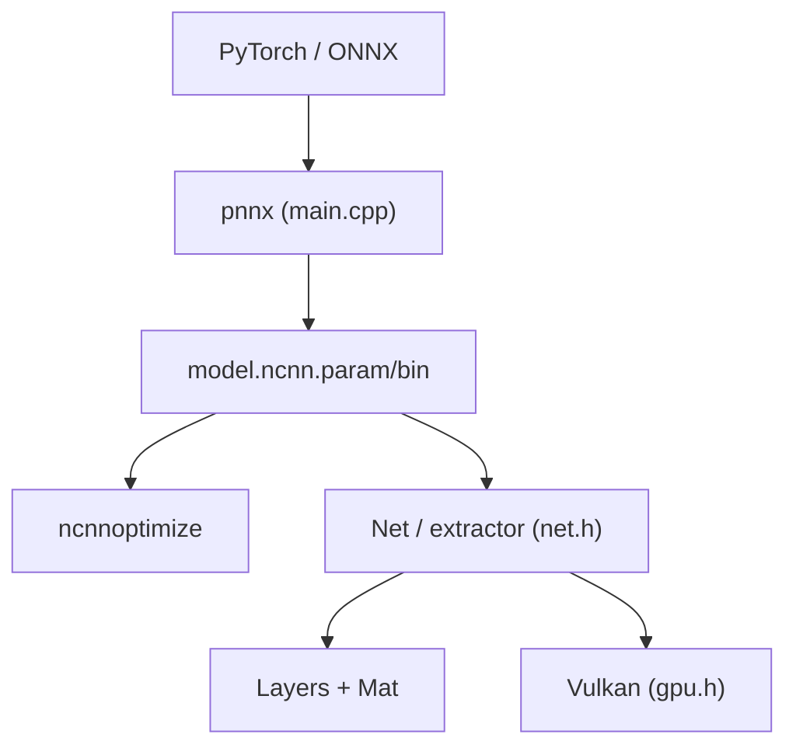

# Tencent/ncnn

> Neural network inference engine for mobile, embedded and desktop, with no runtime dependencies.

## The problem
Deploying a trained model on a phone or embedded board with a lightweight runtime and no heavy dependencies.

## What it actually does
Loads `.param`/`.bin` models and runs them on CPU (NEON, multicore) or Vulkan GPU, in C++ with a C API and a Python binding. The pnnx tool converts PyTorch and ONNX. int8 and fp16 quantization, model optimization, custom layers. Used in QQ and WeChat according to the README.

## How it is wired


## Trying it
```bash
pip3 install pnnx
git clone --recursive https://github.com/Tencent/ncnn.git
cd ncnn
mkdir build && cd build
cmake -DCMAKE_BUILD_TYPE=Release -DNCNN_VULKAN=ON -DNCNN_BUILD_EXAMPLES=ON ..
cmake --build . -j$(nproc)
```

## Cost and gotchas
Free. Build per target (Android, iOS, WASM, etc.); prebuilt packages recommended. License present but not identified by GitHub: to be checked.

## What it is not
Not a training framework. Unsupported operators block conversion; LLMs and generation mostly go through community projects.

## Alternatives
No alternative named in the README.

## For you
Worth watching: relevant only if you deploy inference on mobile or edge; for GPU servers, it is not the right tool.
