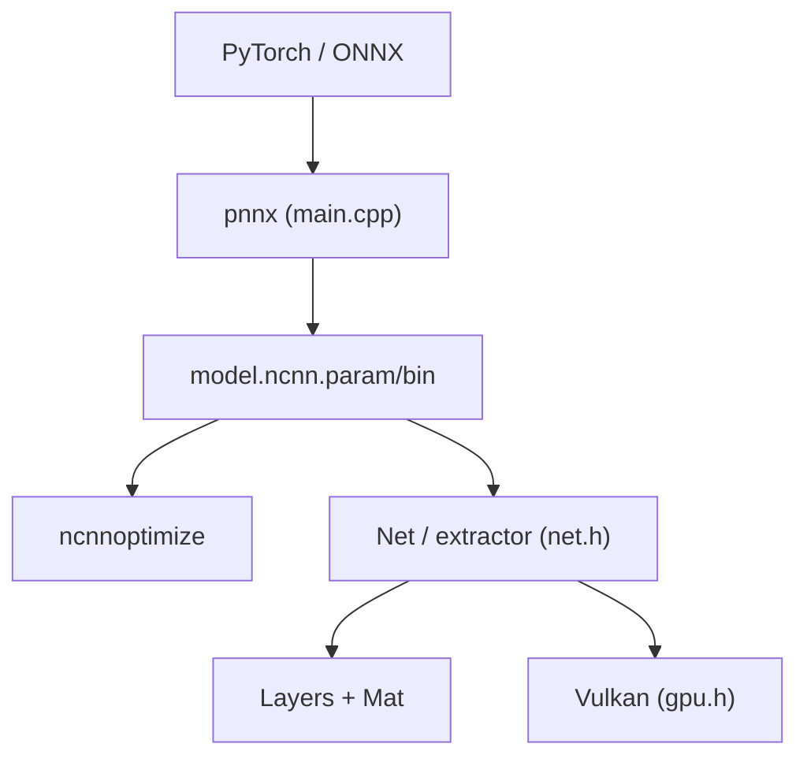

# Tencent/ncnn

> Moteur d'inférence de réseaux de neurones pour mobile, embarqué et desktop, sans dépendance runtime.

## Le problème
Déployer un modèle entraîné sur téléphone ou carte embarquée avec un runtime léger et sans dépendances lourdes.

## Ce que ça fait vraiment
Charge des modèles `.param`/`.bin` et les exécute sur CPU (NEON, multicœur) ou GPU Vulkan, en C++ avec API C et binding Python. L'outil pnnx convertit PyTorch et ONNX. Quantification int8, fp16, optimisation de modèle, couches personnalisées. Utilisé dans QQ et WeChat selon le README.

## Comment c'est branché


## Essayer
```bash
pip3 install pnnx
git clone --recursive https://github.com/Tencent/ncnn.git
cd ncnn
mkdir build && cd build
cmake -DCMAKE_BUILD_TYPE=Release -DNCNN_VULKAN=ON -DNCNN_BUILD_EXAMPLES=ON ..
cmake --build . -j$(nproc)
```

## Coût et pièges
Gratuit. Compilation par cible (Android, iOS, WASM, etc.) ; paquets précompilés recommandés. Licence présente mais non identifiée par GitHub : à vérifier.

## Ce que ce n'est pas
Pas un framework d'entraînement. Les opérateurs non supportés bloquent la conversion ; LLM et génération passent surtout par des projets communautaires.

## Alternatives
Aucune alternative nommée dans le README.

## Pour toi
À surveiller : pertinent seulement si tu déploies de l'inférence sur mobile ou edge ; pour du serveur GPU, ce n'est pas le bon outil.

