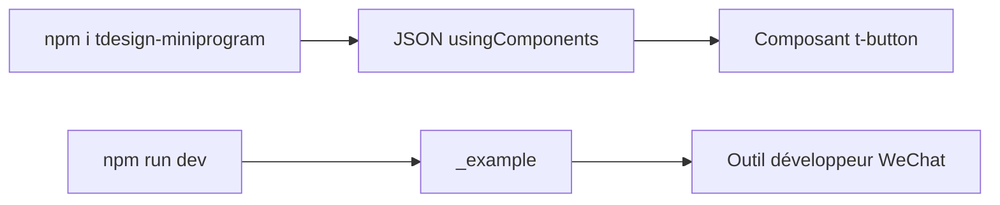

# Tencent/tdesign-miniprogram

> TDesign component library for WeChat mini-programs, for front-end developers.

## The problem
Building the interface of a WeChat mini-program with a coherent set of components.

## What it actually does
Components declared in JSON files (`usingComponents`), installed via NPM; an `_example` sample project can be previewed in the WeChat developer tool. Minimum base: `^2.6.5`. README in Chinese.

## How it is wired


## Trying it
```bash
npm i tdesign-miniprogram -S --production
npm install
npm run dev
```

## Cost and gotchas
Free. The example requires an AppID with the simultaneous translation plugin, otherwise remove `plugins` in `app.json`.

## What it is not
Not a mini-program framework: a UI library.

## Alternatives
No alternative named in the README.

## For you
Ignore: front-end for WeChat, unrelated to data/AI/MLOps.
