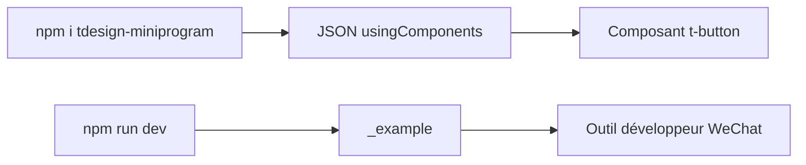

# Tencent/tdesign-miniprogram

> Bibliothèque de composants TDesign pour mini-programmes WeChat, pour développeurs front-end.

## Le problème
Construire l'interface d'un mini-programme WeChat avec un jeu de composants cohérent.

## Ce que ça fait vraiment
Composants à déclarer dans les fichiers JSON (`usingComponents`), installés via NPM ; un projet exemple `_example` se prévisualise dans l'outil de développement WeChat. Base minimale : `^2.6.5`. README en chinois.

## Comment c'est branché


## Essayer
```bash
npm i tdesign-miniprogram -S --production
npm install
npm run dev
```

## Coût et pièges
Gratuit. L'exemple demande un AppID avec le plugin de traduction simultanée, sinon retirer `plugins` dans `app.json`.

## Ce que ce n'est pas
Pas un framework de mini-programme : une bibliothèque d'interface.

## Alternatives
Aucune alternative nommée dans le README.

## Pour toi
À ignorer : front-end pour WeChat, sans rapport avec data/IA/MLOps.

