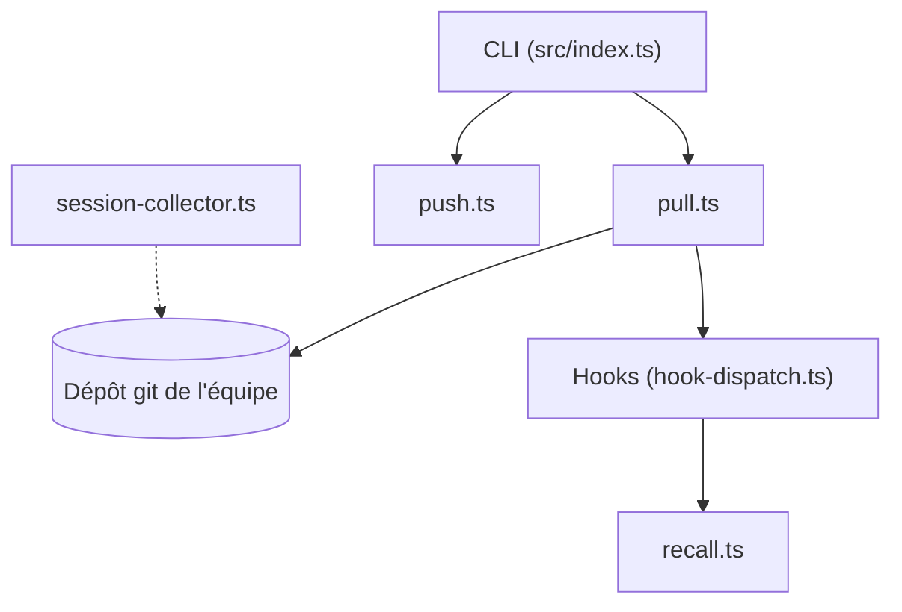

# Tencent/teamai-cli

> CLI that syncs a team's skills, rules, agents and MCP from a git repository to its AI tools.

## The problem
Each developer configures their AI coding tools their own way, and the team's good practices do not circulate.

## What it actually does
A shared git repository holds the team's AI resources. `teamai init` followed by hooks pulls updates at each session, for Claude Code, Codex, Cursor and about twenty others. Beta layers: team context (wiki, code graph, recall) and improvement (redacted transcripts, digest, dashboard).

## How it is wired


## Trying it
```bash
npm install -g teamai-cli
teamai init https://github.com/your-org/your-repo
teamai init https://github.com/your-org/your-repo --scope user
```

## Cost and gotchas
Free, Node required, a shared git repository to create. Supported providers: GitHub, GitLab, GitCode, CNB, TGit. Session collection is optional but touches transcripts, redacted according to the code. License not identified by GitHub.

## What it is not
Not a coding agent: it distributes resources to existing agents. Context and improvement features are still in beta.

## Alternatives
No alternative named in the README.

## For you
Watch: relevant if your team shares Claude Code skills, but young (created in 2026), in beta and without a clear license.
