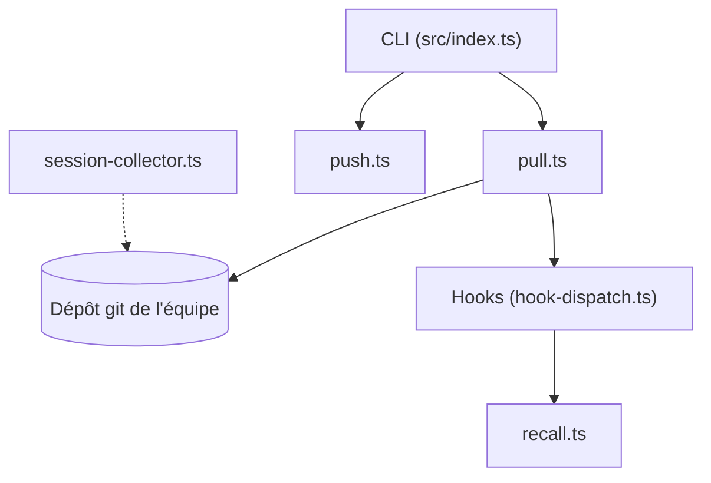

# Tencent/teamai-cli

> CLI qui synchronise skills, règles, agents et MCP d'une équipe depuis un dépôt git vers ses outils d'IA.

## Le problème
Chaque développeur règle ses outils d'IA de codage à sa manière, et les bonnes pratiques de l'équipe ne circulent pas.

## Ce que ça fait vraiment
Un dépôt git partagé contient les ressources d'IA de l'équipe. `teamai init` puis des hooks tirent les mises à jour à chaque session, pour Claude Code, Codex, Cursor et une vingtaine d'autres. Couches bêta : contexte d'équipe (wiki, graphe de code, recall) et amélioration (transcripts expurgés, digest, tableau de bord).

## Comment c'est branché


## Essayer
```bash
npm install -g teamai-cli
teamai init https://github.com/your-org/your-repo
teamai init https://github.com/your-org/your-repo --scope user
```

## Coût et pièges
Gratuit, Node requis, dépôt git partagé à créer. Fournisseurs pris en charge : GitHub, GitLab, GitCode, CNB, TGit. La collecte de sessions est optionnelle mais touche à des transcripts, expurgés selon le code. Licence non identifiée par GitHub.

## Ce que ce n'est pas
Pas un agent de codage : il distribue des ressources aux agents existants. Fonctions de contexte et d'amélioration encore en bêta.

## Alternatives
Aucune alternative nommée dans le README.

## Pour toi
Surveiller : pertinent si ton équipe partage des skills Claude Code, mais jeune (créé en 2026), en bêta et sans licence claire.

