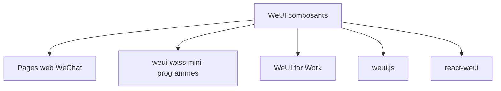

# Tencent/weui

> WeChat-style UI framework, designed by the WeChat design team for the web.

## The problem
Web pages opened inside WeChat must look like the app to stay consistent.

## What it actually does
Provides UI components: button, cell, dialog, progress bar, toast, article, action sheet, icon. A mobile demo exists at weui.io. Variants exist for mini-programs (weui-wxss), WeChat Work, weui.js and react-weui. The README is short.

## How it is wired
Simplified diagram based on the sheet, no diagram provided.

## Trying it
No command documented in the README, which points to the wiki and the demo.

## Cost and gotchas
Free. Installation method not documented in the README. A license is present but not identified by GitHub: to be checked. The old 0.4.x and 1.x lines remain online.

## What it is not
It is not a general-purpose framework: it targets the WeChat ecosystem. It is not a data or AI tool.

## Alternatives
No alternative named in the README.

## For you
Ignore: without a WeChat project it has no use; for a data dashboard, a general-purpose component is enough.
