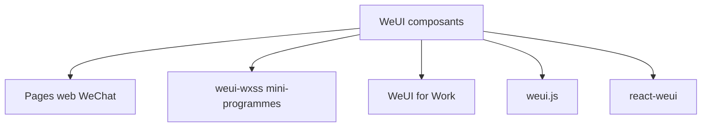

# Tencent/weui

> Framework d'interface au style WeChat, conçu par l'équipe de design de WeChat pour le web.

## Le problème
Les pages web ouvertes dans WeChat doivent ressembler à l'application pour rester cohérentes.

## Ce que ça fait vraiment
Fournit des composants d'interface : bouton, cellule, dialogue, barre de progression, toast, article, feuille d'actions, icône. Une démo mobile existe sur weui.io. Des variantes existent pour mini-programmes (weui-wxss), WeChat Work, weui.js et react-weui. Le README est court.

## Comment c'est branché
Schéma simplifié d'après la fiche, sans diagramme fourni.

## Essayer
Aucune commande documentée dans le README, qui renvoie au wiki et à la démo.

## Coût et pièges
Gratuit. Mode d'installation non documenté dans le README. Licence présente mais non identifiée par GitHub : à vérifier. Les anciennes lignes 0.4.x et 1.x restent en ligne.

## Ce que ce n'est pas
Ce n'est pas un framework généraliste : il vise l'écosystème WeChat. Ce n'est pas un outil data ou IA.

## Alternatives
Aucune alternative nommée dans le README.

## Pour toi
À ignorer : sans projet pour WeChat, il n'a aucun usage ; pour un tableau de bord data, un composant généraliste suffit.

