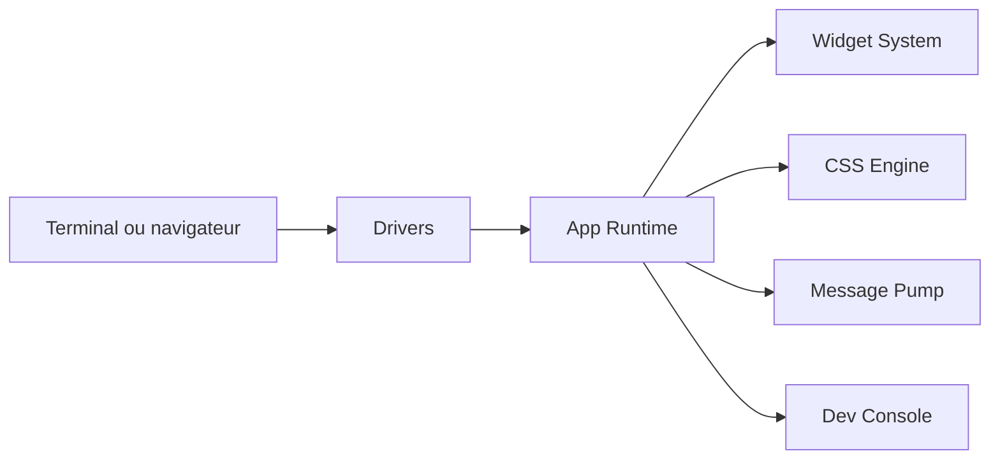

# Textualize/textual

> Python framework for building interfaces that run in the terminal or in a browser.

## The problem
Writing an interactive interface (tables, forms, editor) for an internal tool forces you to build a web front end, when the terminal would be enough.

## What it actually does
An application declares its widgets, styles them in CSS and reacts to events. The core handles DOM, CSS, reactive system, message loop, workers and animation; drivers isolate Linux, Windows, the web and headless mode. Dev tools (`textual-dev`) provide a debug console, a command palette and a testing framework.

## How it is wired


## Trying it
```bash
pip install textual textual-dev
python -m textual
uvx --python 3.12 textual-demo
textual serve "python -m textual"
```

## Cost and gotchas
Free. `uvx` is required for the no-install demo. Async mode exists but is not mandatory.

## What it is not
It is not a scientific plotting library; it is an interface framework. The Textual Web service, mentioned for sharing, is a separate service.

## Alternatives
No alternative named in the README.

## For you
Worth adopting to give your terminal scripts and MLOps tools (training monitoring, data exploration) a polished interface without writing a web front end.
