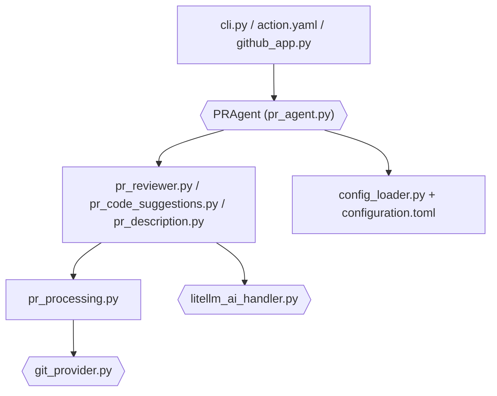

# The-PR-Agent/pr-agent

> Open source agent that reviews, describes and improves pull requests with an LLM, for dev teams.

## The problem
PR reviews are slow and the context of a large diff quickly exceeds a model's window.

## What it actually does
- Commands `/review`, `/describe`, `/improve`, `/ask`, `/similar_issue`, as a PR comment or via CLI.
- Each tool makes a single LLM call (~30 s according to the README).
- Compresses large PRs to fit the token budget before the call.
- Prompts and settings in TOML, overridable per repository. Models via LiteLLM: OpenAI, Claude, Gemini, Ollama, etc.

## How it is wired


## Trying it
```bash
pip install "pr-agent[github]"
export OPENAI_KEY=your_key_here
pr-agent --pr_url https://github.com/owner/repo/pull/123 review
```
Or the GitHub Action `the-pr-agent/pr-agent@main` with `OPENAI_KEY` and `GITHUB_TOKEN`.

## Cost and gotchas
LLM API key is on you. `/help_docs` has been disabled since v0.36.1 (credential leak, #2445). Docker images now under `pragent/pr-agent` (0.34.2+).

## What it is not
Not Qodo's commercial offering: a legacy project maintained by the community. The PR content is sent to the chosen LLM provider.

## Alternatives
- Qodo's offering for open source: cited by the README as richer and more contextual.

## For you
Adopt it if you want automated, self-hosted PR review, with the model of your choice (including local via Ollama); MIT and recent activity.
