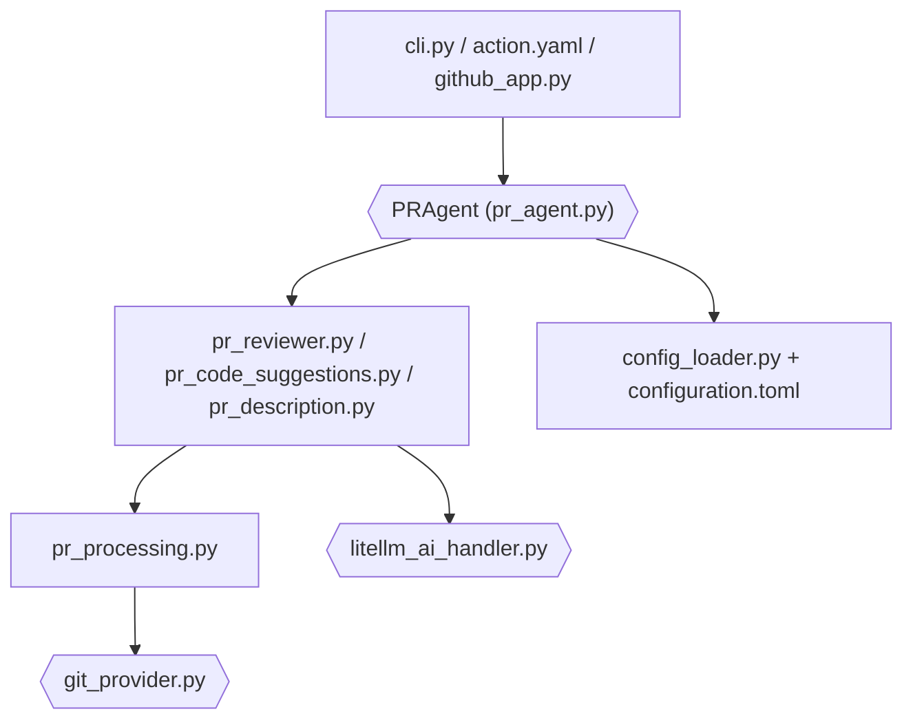

# The-PR-Agent/pr-agent

> Agent open source qui relit, décrit et améliore des pull requests avec un LLM, pour équipes de dev.

## Le problème
Les revues de PR sont lentes et le contexte d'un gros diff dépasse vite la fenêtre d'un modèle.

## Ce que ça fait vraiment
- Commandes `/review`, `/describe`, `/improve`, `/ask`, `/similar_issue`, en commentaire de PR ou en CLI.
- Chaque outil fait un seul appel LLM (~30 s d'après le README).
- Compresse les gros PR dans le budget de jetons avant l'appel.
- Prompts et réglages en TOML, surchargeables par dépôt. Modèles via LiteLLM : OpenAI, Claude, Gemini, Ollama, etc.

## Comment c'est branché


## Essayer
```bash
pip install "pr-agent[github]"
export OPENAI_KEY=your_key_here
pr-agent --pr_url https://github.com/owner/repo/pull/123 review
```
Ou la GitHub Action `the-pr-agent/pr-agent@main` avec `OPENAI_KEY` et `GITHUB_TOKEN`.

## Coût et pièges
Clé d'API LLM à ta charge. `/help_docs` est désactivé depuis v0.36.1 (fuite d'identifiants, #2445). Images Docker désormais sous `pragent/pr-agent` (0.34.2+).

## Ce que ce n'est pas
Pas l'offre commerciale de Qodo : projet legacy maintenu par la communauté. Le contenu du PR part chez le fournisseur LLM choisi.

## Alternatives
- Offre Qodo pour l'open source : citée par le README comme plus riche et contextuelle.

## Pour toi
À adopter si tu veux une revue de PR automatisée et auto-hébergée, modèle au choix (y compris local via Ollama) ; MIT et activité récente.

