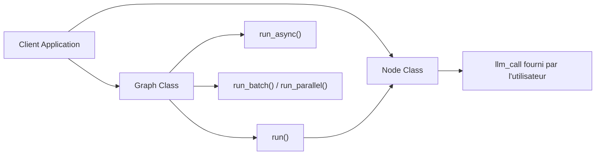

# The-Pocket/PocketFlow

> Python micro-framework for graph-based LLM orchestration, for those who want agents without heavy dependencies.

## The problem
LLM frameworks (LangChain, CrewAI…) ship hundreds of thousands of lines and provider wrappers. Hard to understand or audit what runs.

## What it actually does
A single module (`pocketflow/__init__.py`, ~100 lines) defines Node, Flow/Graph and their execution modes (sync, async, batch, parallel).
The LLM call is supplied by your code: no provider SDK imported.
Agents, RAG, map-reduce, multi-agents are built by composing nodes.
About forty tutorials (chat, RAG, MCP, A2A, text2SQL, coding agent) serve as templates.

## How it is wired


## Trying it
```bash
pip install pocketflow
```

## Cost and gotchas
Free; you pay the LLM provider you plug in. No integration provided: everything (retries, tools, memory) is yours to write.

## What it is not
Not a turnkey agent platform nor an integration catalog. The "agentic coding" pitch (letting Cursor write the agent) is a method, not a feature of the code.

## Alternatives
- LangGraph: same graph abstraction, with persistence (SqliteSaver…) if you need it.
- CrewAI: if you want prebuilt agent tools and roles.
- SmolAgent: code-oriented agents with Hugging Face tools.

## For you
Watch: excellent teaching material for understanding agent orchestration, but for MLOps production you will have to rewrite the tooling that LangGraph already provides.
