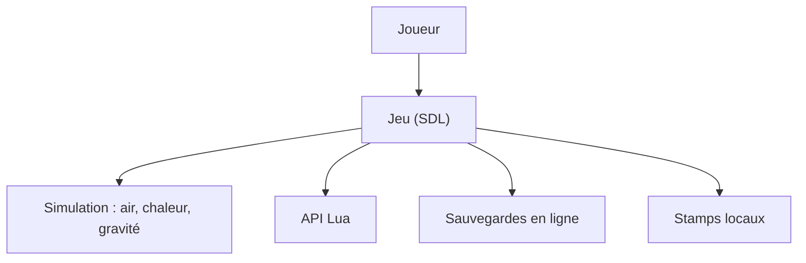

# The-Powder-Toy/The-Powder-Toy

> Physics sandbox game simulating pressure, heat and materials, for players and curious minds.

## The problem
Safely observing explosions, circuits or reactions between materials requires an interactive simulator.

## What it actually does
The game simulates air pressure and velocity, heat, gravity and many interactions between substances. You draw with the mouse, share saves online (account required) and browse the community's saves. A Lua API lets you automate things or write extensions. Sources under GPL.

## How it is wired
Simplified diagram based on the sheet, no diagram provided.


## Trying it
```bash
ptsave:2198
scale:2
disable-network
```

## Cost and gotchas
Free. An account is needed to save and publish online. To build it, the README points to the wiki, without a command.

## What it is not
Not a scientific simulation tool: it is a game. It is not a data or AI work tool.

## Alternatives
No alternative named in the README.

## For you
Ignore: a physics game unrelated to your work, reserved for your free time.
