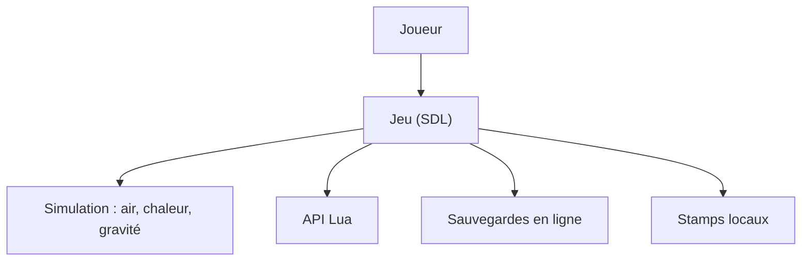

# The-Powder-Toy/The-Powder-Toy

> Jeu bac à sable de physique simulant pression, chaleur et matières, pour joueurs et curieux.

## Le problème
Observer sans risque explosions, circuits ou réactions entre matières demande un simulateur interactif.

## Ce que ça fait vraiment
Le jeu simule pression et vitesse de l'air, chaleur, gravité et de nombreuses interactions entre substances. Tu dessines à la souris, partages des sauvegardes en ligne (compte requis) et parcours celles de la communauté. Une API Lua permet d'automatiser ou d'écrire des extensions. Sources sous GPL.

## Comment c'est branché
Schéma simplifié d'après la fiche, sans diagramme fourni.


## Essayer
```bash
ptsave:2198
scale:2
disable-network
```

## Coût et pièges
Gratuit. Compte à créer pour sauvegarder et publier en ligne. Pour compiler, le README renvoie au wiki, sans commande.

## Ce que ce n'est pas
Pas un outil de simulation scientifique : c'est un jeu. Ce n'est pas un outil de travail data ou IA.

## Alternatives
Aucune alternative nommée dans le README.

## Pour toi
À ignorer : un jeu de physique sans lien avec ton travail, réservé à ton temps libre.

