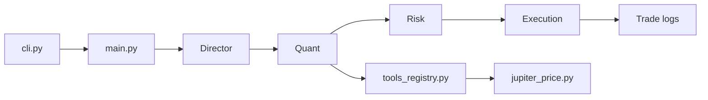

# The-Swarm-Corporation/AutoHedge

> LLM agent pipeline that analyzes the crypto market and places orders on Solana.

## The problem
Chaining investment thesis, quantitative analysis, risk sizing and execution requires a lot of glue between data and brokers.

## What it actually does
Four agents in series (Swarms framework): Director (thesis), Quant (analysis), Risk (position size), Execution (orders).
Data tools: Jupiter (prices, search), Polygon, Yahoo, Exa.
Execution on Solana with the wallet's private key; trade logs in CSV.
`experimental/` folder: market making, BTC agent.

## How it is wired


## Trying it
```bash
pip install -U autohedge
autohedge
```

## Cost and gotchas
Jupiter, OpenAI, Anthropic keys at your expense, plus `WALLET_PRIVATE_KEY`: real funds go out.

## What it is not
Not an "enterprise-grade" fund despite the README: no backtest or published results. Coinbase and other venues are only announced.

## Alternatives
No alternative named in the README.

## For you
Ignore: entrusting a wallet private key to a chain of LLMs without measured validation is a gamble, not engineering.
