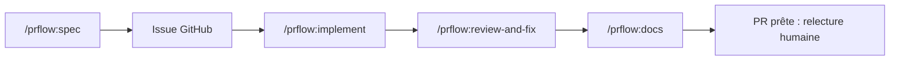

# The01Geek/prflow

> Claude Code plugin that takes a feature request all the way to a tested, reviewed and documented pull request.

## The problem
Coding agents stall on a real ticket in a large codebase: branch, tests, review and docs are left to do.

## What it actually does
`/prflow:spec` turns an idea into a GitHub issue after confirmation. `/prflow:implement` creates the branch, plans, codes, tests, opens a draft PR, runs a review-and-fix loop with a "shadow" pass, updates the docs, then marks the PR ready. A weekly retrospective opens issues for recurring failures. No automatic merge.

## How it is wired


## Trying it
```bash
claude plugin marketplace add The01Geek/prflow
claude plugin install prflow@devflow-marketplace
claude /prflow:init
```
Then in Claude Code: `/prflow:spec <user_story>` and `/prflow:implement <issue_number>`.

## Cost and gotchas
Claude Code subscription or tokens, `git`, `gh`, `jq`, Python 3.11+ and PyYAML 6+ (to install yourself). The cloud tier requires a `CLAUDE_CODE_OAUTH_TOKEN` secret. An automatic review feature was removed because of a vulnerability.

## What it is not
Not an autonomous agent that merges: the final review is human. Quality diagnosis remains that of the review pass, which does not replace an independent review, according to the author.

## Alternatives
None named in the README.

## For you
Keep an eye on it: interesting workflow for delivering PRs with Claude Code, but young, dependent on Claude and with a high token cost.
