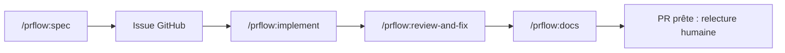

# The01Geek/prflow

> Plugin Claude Code qui mène une demande de fonctionnalité jusqu'à une pull request testée, relue et documentée.

## Le problème
Les agents de code calent sur un vrai ticket dans une grosse base : branche, tests, relecture et docs restent à faire.

## Ce que ça fait vraiment
`/prflow:spec` transforme une idée en issue GitHub après confirmation. `/prflow:implement` crée la branche, planifie, code, teste, ouvre une PR brouillon, lance une boucle de relecture et correction avec une passe « shadow », met à jour les docs, puis marque la PR prête. Une rétrospective hebdomadaire ouvre des issues pour les échecs récurrents. Pas de fusion automatique.

## Comment c'est branché


## Essayer
```bash
claude plugin marketplace add The01Geek/prflow
claude plugin install prflow@devflow-marketplace
claude /prflow:init
```
Puis dans Claude Code : `/prflow:spec <user_story>` et `/prflow:implement <issue_number>`.

## Coût et pièges
Abonnement ou jetons Claude Code, `git`, `gh`, `jq`, Python 3.11+ et PyYAML 6+ (à installer soi-même). Le niveau cloud demande un secret `CLAUDE_CODE_OAUTH_TOKEN`. Une fonction de relecture automatique a été retirée pour une faille.

## Ce que ce n'est pas
Pas un agent autonome qui fusionne : la dernière revue est humaine. Le diagnostic de qualité reste celui de la passe de relecture, qui ne rattrape pas une revue indépendante, selon l'auteur.

## Alternatives
Aucune nommée dans le README.

## Pour toi
Surveiller : workflow intéressant pour livrer des PR avec Claude Code, mais jeune, dépendant de Claude et à coût de jetons élevé.

