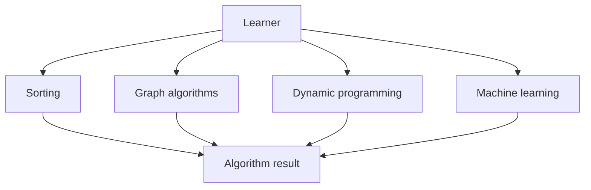

# TheAlgorithms/C-Plus-Plus

> Collection of algorithms in C++17, with no dependencies, for learning and teaching.

## The problem
Studying an algorithm requires a readable, documented and tested implementation, without an external library hiding the principle.

## What it actually does
Standalone C++17 programs sorted by theme: sorting, searching, graphs, dynamic programming, data structures, strings, mathematics, numerical methods, probability, machine learning, encryption, CPU scheduling. Each file contains self-tests. Compilation is tested on every commit on Windows, macOS and Ubuntu.

## How it is wired

## Trying it
No command documented in the README; it points to the online documentation and the contribution guide.

## Cost and gotchas
Free. Documentation under the CC BY-SA 4.0 license, code under MIT.

## What it is not
Not a reusable production library: there is no common pipeline, each program is independent. The machine learning folder is teaching material.

## Alternatives
No alternative named in the README.

## For you
A learning resource with no value for an already trained data/AI profile, who uses proven Python libraries: ignore.
