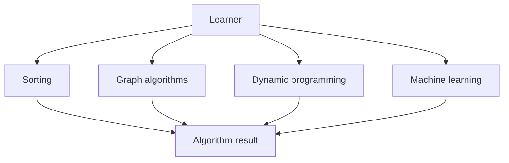

# TheAlgorithms/C-Plus-Plus

> Collection d'algorithmes en C++17, sans dépendances, pour apprendre et enseigner.

## Le problème
Étudier un algorithme demande une implémentation lisible, documentée et testée, sans bibliothèque externe qui masque le principe.

## Ce que ça fait vraiment
Programmes C++17 autonomes classés par thème : tri, recherche, graphes, programmation dynamique, structures de données, chaînes, mathématiques, méthodes numériques, probabilités, apprentissage automatique, chiffrement, ordonnancement CPU. Chaque fichier contient des auto-tests. Compilation testée à chaque commit sous Windows, macOS et Ubuntu.

## Comment c'est branché

## Essayer
Aucune commande documentée dans le README ; il renvoie à la documentation en ligne et au guide de contribution.

## Coût et pièges
Gratuit. Documentation sous licence CC BY-SA 4.0, code sous MIT.

## Ce que ce n'est pas
Pas une bibliothèque réutilisable en production : il n'y a pas de pipeline commun, chaque programme est indépendant. Le dossier d'apprentissage automatique est un support pédagogique.

## Alternatives
Aucune alternative nommée dans le README.

## Pour toi
Ressource d'apprentissage sans valeur pour un profil data/IA déjà formé, qui utilise des bibliothèques Python éprouvées : à ignorer.

