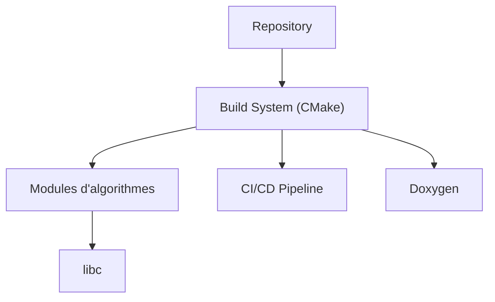

# TheAlgorithms/C

> Community collection of algorithms in C, for educational purposes, for students and teachers.

## The problem
Learning algorithms requires readable, commented and testable implementations, with no external dependency.

## What it actually does
Standalone C11 implementations (libc only): sorting, searching, data structures, dynamic programming, encryption, ML, Project Euler, games. Self-checks within the programs, CI on macOS and Ubuntu, Doxygen documentation generated from the code.

## How it is wired

## Trying it
No command documented in the README. Clone the repository, then build via the `CMakeLists.txt` (not detailed here).

## Cost and gotchas
No cost. Last push in August 2024: maintenance has slowed.

## What it is not
Not a production library: learning examples. GPL-3.0: reusing the code imposes copyleft.

## Alternatives
No alternative named in the README.

## For you
Ignore for a data/MLOps profile: school resource, GPL-3.0, little use in production.
